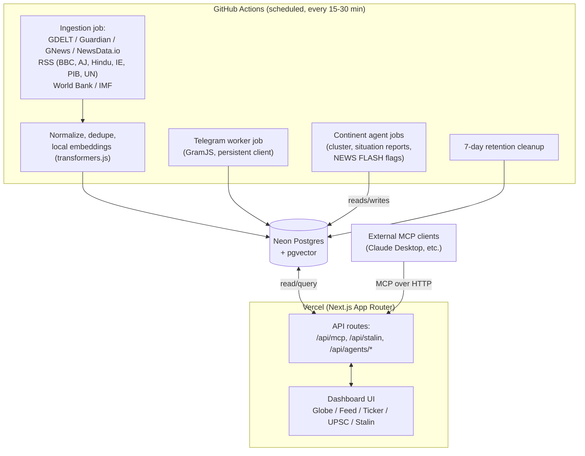

# PLAN: Global Intelligence Command Center — "SITREP"

> Status: research & planning complete, decisions confirmed with you in chat.
> No application code written yet — this is the written plan required by
> brief §4 step 1. Phase 1 (GitHub + Vercel setup) starts after this is saved.

> ⚠️ Web search/fetch tools were unavailable during research, so items marked
> **[VERIFY]** are from training knowledge (cutoff ~early 2026) and should be
> re-checked against the live docs (links given) before we lock them in at the
> relevant phase — matching the brief's own instruction not to rely on memory.

---

## 0. Confirmed decisions (from chat)

| Decision | Choice |
|---|---|
| Product name | **SITREP** (assistant keeps the requested name **Stalin**) |
| GitHub repo visibility | **Public** — unlimited free Actions minutes; secrets still protected via GitHub Secrets |
| App access | **Single-user, no login/auth** |
| ACLED | **Skipped** — use GDELT conflict/protest codes + news instead |
| Live market/forex data | **Skipped for MVP** — "economy" is a news-derived category; revisit later |
| NewsAPI.org | **Dropped** — free tier forbids production/deployed use |
| Database | **Neon** (Postgres + pgvector) |
| Push notifications | **Skipped for MVP** |

---

## 1. Data sources — final list & notes

| Source | Verdict | Notes |
|---|---|---|
| **GDELT 2.0** (Events + GKG) | Backbone | Free, no API key, updated every ~15 min, geocoded. Pulled from `data.gdeltproject.org/gdeltv2/lastupdate.txt`. **[VERIFY]** current terms at gdeltproject.org/about. |
| **The Guardian Open Platform** | Use | Free dev key, historically ~5000 calls/day, ~12/sec. Free tier allows headline + trail text + link-back, not full-text republishing — matches the "link only" requirement. **[VERIFY]** open-platform.theguardian.com/access. |
| **GNews** | Use (small quota) | Historically ~100 req/day free, production-allowed. **[VERIFY]** gnews.io/docs. |
| **NewsData.io** | Use (small quota) | Historically ~200 credits/day free, latest-news only, production-allowed. **[VERIFY]** newsdata.io/documentation. |
| **RSS**: BBC World, Al Jazeera, The Hindu, Indian Express, UN News | Use | Standard public RSS, headline+summary+link only, no key. Poll politely on the 15–30 min cadence. |
| **PIB (Press Information Bureau)** | Use | Per-ministry RSS feeds on pib.gov.in — confirm exact current feed URLs at build time. |
| **MEA India** | Scrape fallback | **[VERIFY]** whether mea.gov.in now exposes RSS; if not, a low-frequency, isolated HTML-scrape adapter of the public press-release listing. |
| **World Bank API** | Use | Free, open, no key — slow-moving macro indicators. |
| **IMF API** | Use | Free, open, no key. |
| **RBI** | No public API | Treated as ordinary "economy"-tagged news via keyword/GDELT matching, not structured data. |
| **Telegram (MTProto/GramJS)** | Use, with care | See §4. |
| ~~ACLED~~ | Skipped | Licensing gray area for public deployment — see §0. |
| ~~NewsAPI.org~~ | Dropped | Free tier forbids production deployment — see §0. |
| ~~Live market/forex/commodity feed~~ | Skipped for MVP | No robust always-free API covering all three without quota issues — see §0. |

**Plug-in architecture:** every source is one adapter implementing a shared
`SourceAdapter` interface (`fetch(): Promise<RawItem[]>`), registered in
`lib/sources/registry.ts`. Adding a source later = one adapter file + one
registry line. `SOURCES.md` documents every source, its type, limits and terms
link, and is updated whenever a source is added.

Every item retains: title, summary, source name, original URL, published time,
location (lat/lng + country + continent), category, severity score, tags.
Only headlines/summaries/metadata/links are stored — never full article text.

---

## 2. Hosting & infrastructure

| Piece | Choice | Rationale **[VERIFY before build]** |
|---|---|---|
| Hosting | **Vercel Hobby (free)** | Best Next.js fit. Hobby cron is historically too limited (as few as 1–2 runs/day) for 15–30 min ingestion, so cron is **not** used for that. |
| Scheduler | **GitHub Actions `schedule:` workflows** (public repo) | Unlimited free minutes on a public repo vs. ~2000 min/month on private. Runs ingestion/Telegram/agents/cleanup every 15–30 min. Free-tier scheduling isn't exact-to-the-minute — acceptable at this cadence. |
| Database | **Neon free tier, Postgres + pgvector** | `@neondatabase/serverless` HTTP driver fits Vercel's serverless/edge functions well; autosuspend only adds a brief cold start (vs. Supabase's full pause after inactivity) — moot anyway since ingestion runs every 15–30 min. |
| LLM (agents + Stalin) | **Groq free tier**, provider swappable via env var (Anthropic Claude etc. supported) | Exact current free-tier models/limits **must** be confirmed at console.groq.com/docs right before Phase 5, since Groq's lineup changes. Model name lives in an env var for one-line swaps. |
| Embeddings (7-day similarity search) | **Local model via `transformers.js`** (e.g. all-MiniLM-L6-v2), run inside the GitHub Action | Zero cost, no external API/key, no rate limit — runs on the Action runner's CPU during ingestion. 384-dim vectors stored in Neon's pgvector column. |

**Cost target ₹0** — every piece above has a free tier sufficient for this app's scale (headlines only, 7-day rolling window, infrequent batched LLM calls).

---

## 3. Architecture



**Data flow, in words:** Every 15–30 min, GitHub Actions pulls fresh items from
every source adapter, normalizes them into one shape, drops duplicates, computes
a small local embedding per new item, and writes everything to Neon. Separately,
each continent agent job reads its region's new items, clusters related stories,
writes a short situation report, and flags high-severity items as NEWS FLASH. A
cleanup step purges items older than 7 days. Vercel never ingests anything — it
only reads from Neon to serve the UI and API routes (dashboard, Stalin chat, MCP
endpoint), which is why cron/serverless limits on Vercel don't matter.

---

## 4. Telegram plan (brief §1.2)

1. **You** create an app at my.telegram.org to get `api_id` + `api_hash` — I'll give exact numbered steps at Phase 8, not now.
2. **Locally on your machine only** (never on Vercel, never in the deployed app) you run a one-time GramJS script that logs in interactively and prints a **session string**. That string goes into a GitHub Actions **encrypted secret** — never committed, never logged, never sent elsewhere.
3. A second local script lists every channel/group your account has joined, so you pick which to ingest into one config file (`telegram-channels.json`); an "ingest all joined channels" mode is also supported.
4. Ingestion runs as a **GitHub Actions scheduled job** (not Vercel — serverless functions can't hold a persistent MTProto connection). Reads **channels only**, never private chats/contacts/DMs. Respects FloodWait with automatic backoff.
5. **Fallback:** if MTProto login isn't workable, scrape public `t.me/s/<channel>` web previews instead (no login needed, lower fidelity).

**Known risk:** automating a personal account carries a small chance of a temporary Telegram restriction if too many channels are polled too aggressively. Mitigated with conservative per-channel intervals and FloodWait handling, but worth knowing going in.

---

## 5. Database schema (initial draft, Postgres + pgvector)

```
sources(id, name, type, homepage_url, terms_url, enabled, created_at)

items(id, source_id -> sources, title, summary, url UNIQUE, published_at,
      category, severity smallint, lat, lng, country, continent,
      region_tag,       -- e.g. 'south_asia_national' | 'south_asia_international' | ...
      content_hash,     -- de-dup key
      created_at)

item_tags(item_id -> items, tag text)             -- free-form + UPSC tags
upsc_tags(item_id -> items, gs_paper text, topic text)

embeddings(item_id -> items PK, vector vector(384))

situation_reports(id, region, generated_at, summary_md, item_ids int[],
                   is_news_flash bool, severity smallint)

telegram_channels(id, chat_id, title, username, enabled)

bookmarks(id, note_md, snapshot_json,      -- full snapshot, not just a FK
          source_item_id -> items NULLABLE, created_at)

chat_messages(id, role, content, context_item_id, created_at)   -- Stalin history
```

**Design note:** `bookmarks` stores a **snapshot** of the item, not only a
foreign key — so the 7-day cleanup job purging `items`/`embeddings` never
destroys your saved UPSC notes. `situation_reports` (digest archive) and
`bookmarks` persist indefinitely unless you delete them yourself.

---

## 6. Folder structure (Next.js App Router)

```
app/
  (dashboard)/page.tsx
  api/
    mcp/route.ts            # MCP server endpoint (streamable HTTP transport)
    stalin/route.ts         # streaming chat
    agents/[region]/route.ts
    digest/route.ts
  globals.css
components/
  globe/   feed/   ticker/   upsc/   assistant/   layout/
lib/
  db/          # drizzle schema + Neon client
  sources/     # registry.ts + one adapter file per source
  agents/      # continent agent logic + MCP-style tool functions
  embeddings/
  mcp/
scripts/       # run by GitHub Actions (tsx): ingest.ts, telegram-session-gen.ts,
               # telegram-worker.ts, agents-run.ts, cleanup.ts
.github/workflows/  ingest.yml   agents.yml   telegram.yml
SOURCES.md   DEPLOY_GUIDE.md   README.md   .env.example
```

---

## 7. Phased build plan (brief §4 step 2)

1. **Phase 1** — Project setup, GitHub repo (public), first Vercel deploy of a basic page. Teach GitHub + Vercel basics step by step.
2. **Phase 2** — UI shell: responsive layout, dark command-center theme, navigation, globe with mock data.
3. **Phase 3** — Data ingestion pipeline + Neon database + real events on the map.
4. **Phase 4** — Feeds, filters, news flash ticker, 7-day archive and timelines.
5. **Phase 5** — Continent agents + MCP endpoint.
6. **Phase 6** — Stalin assistant.
7. **Phase 7** — UPSC mode, digest, notes export.
8. **Phase 8** — Telegram integration, PWA, performance polish, mobile-viewport testing.

Each phase: run the app, check build/lint/type-check, test mobile + desktop viewports, commit with a clear message, and a short note on what to verify — per brief §4 step 3.

---

## 8. Risks

1. ACLED licensing ambiguity for public deployment → resolved by skipping it (GDELT instead).
2. NewsAPI.org free tier forbids production → resolved by dropping it.
3. No public RBI API / no all-free market-data API → resolved: economy is a news-derived category for MVP.
4. MEA India may lack RSS → isolated scrape adapter, easy to swap if the site changes.
5. GitHub Actions free scheduler timing isn't exact → fine at 15–30 min cadence.
6. Telegram personal-account automation → small restriction risk, mitigated with conservative polling + FloodWait handling.
7. Groq free-tier limits shared across 8 continent agents + Stalin chat → mitigated via scheduled (not per-request) runs, batching, caching.
8. All **[VERIFY]** items above need a live re-check against current docs before the phase that depends on them, since this research pass was done without working web-browsing tools.

---

## 9. Still open / to confirm when relevant

- Exact Groq model names/limits — confirm at Phase 5.
- Exact current free-tier quotas for Guardian/GNews/NewsData.io — confirm at Phase 3.
- Exact PIB feed URLs and whether MEA has RSS now — confirm at Phase 3.
- Vercel Hobby cron/function limits, GitHub Actions free-minute figures, Neon free-tier storage cap — confirm before relying on them.
